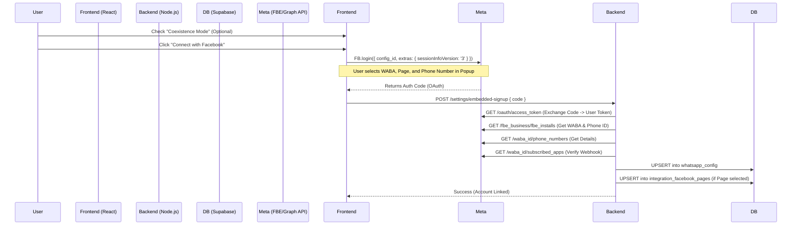

# WhatsApp Embedded Signup (Coexistence) - End-to-End Documentation

## 1. Overview
The "WhatsApp Embedded Signup" feature allows users to onboard their WhatsApp Business Account (WABA) directly onto the platform without leaving the application. This implementation includes support for **Coexistence Mode** (Cloud API Coexistence), which enables users to continue using the WhatsApp Business App (mobile) alongside the API for the *same* phone number.

## 2. Architecture & Flow



## 3. Configuration & Credentials

### A. Environment Variables
*   `FACEBOOK_APP_ID`: The App ID of your Meta Application.
*   `FACEBOOK_APP_SECRET`: The App Secret (Used to sign token exchange requests).
*   `FACEBOOK_CONFIG_ID`: **Critical**. This ID (created in Meta Dev Portal under "WhatsApp" > "Configuration") defines the permissions and strict flow (WABA selection, Phone selection) required for the Embedded Signup.

### B. Coexistence Mode
When "Coexistence Mode" is enabled by the user toggle:
*   The frontend passes `extras: { featureType: 'whatsapp_business_app_onboarding', sessionInfoVersion: '3' }` to `FB.login`.
*   This triggers a specific flow in the Meta Popup that allows selecting a phone number currently registered on the WhatsApp Business App without forcing a complete disconnect.

## 4. Database Schema

### Table: `whatsapp_config`
Stores the credentials for the connected WhatsApp number.

| Column | Type | Description |
| :--- | :--- | :--- |
| `id` | uuid | Primary Key |
| `user_id` | uuid | Foreign Key to `auth.users` |
| `phone_number` | text | The formatted phone number (e.g., `+15550199`) |
| `phone_number_id` | text | Typically `1008...` (The Graph API Network ID) |
| `whatsapp_business_account_id` | text | The WABA ID |
| `meta_access_token` | text | **System User Access Token** (Permanent). Acquired during the exchange flow. |
| `meta_app_id` | text | The App ID used for this connection. |
| `business_profile` | jsonb | Stores profile data (address, email, website) fetched from Meta. |

## 5. API Reference (Internal Backend)

### 1. Connect Embedded Account
*   **Endpoint**: `POST /api/settings/embedded-signup`
*   **Body**: `{ "code": "...", "wabaId": "auto", "phoneId": "auto" }`
*   **Logic**:
    1.  **Exchange Code**: Swap the received OAuth `code` for a long-lived User Access Token.
    2.  **Fetch Installation**: Query `/fbe_business/fbe_installs` to find exactly what resources the user selected in the popup (WABA ID, Phone ID).
    3.  **Fetch System User Token**: (Advanced) Often the flow tries to fetch a token closer to the business. In this implementation, we often use the Long-Lived User Token or generate a System User Token if the App is shared.
    4.  **Register Webhook**: Subscribe the app to the WABA's webhooks.
    5.  **Save to DB**: Store all credentials in `whatsapp_config`.

## 6. Codebase Breakdown

### Frontend (Client)
*   **`src/components/WhatsAppManagement/AccountSetup.tsx`**:
    *   **UI Component**: Renders the "Connect with Facebook" banner and Coexistence Toggle.
    *   **FB SDK**: Initializes `FB.init` with the App ID.
    *   **Login Logic**: Calls `FB.login` with the specific `config_id` and `extras` payload for Coexistence.
        ```javascript
        extras: isCoexistenceEnabled ? {
            featureType: 'whatsapp_business_app_onboarding',
            sessionInfoVersion: '3'
        } : undefined
        ```

### Backend (Server)
*   **`server/services/MetaOnboardingService.js`** (Assumed/Implied):
    *   **`connectEmbeddedAccount(code)`**: Master function orchestrating the flow.
    *   **Refined Logic**: Unlike standard OAuth, this service parses the specific `fbe_installs` structure to automatically detect the selected phone number.

*   **`server/routes/webhook.js`**:
    *   **Coexistence Events**: Handles specific webhook events generated by numbers in Coexistence mode:
        *   `SMB_APP_STATE_SYNC`: Syncs contacts added/removed via the mobile app.
        *   `message_echoes`: Receives messages sent *from* the mobile app ensuring the API conversation history remains complete.

## 7. Troubleshooting
*   **"Config ID Missing"**: The `.env` file must have `FACEBOOK_CONFIG_ID`. This is separate from the App ID.
*   **"User Cancelled"**: Common if the user closes the popup.
*   **"Permissions Error"**: Verify the **System User** attached to the App in Meta Business Settings has `admin` access to the requested assets.
*   **"Coexistence Not Working"**: Ensure the `sessionInfoVersion: '3'` is strictly passed. If using an older API version, this might be ignored.

## 8. Requirements for Production
*   **App Verification**: The Facebook App must be "Live" and "Business Verified" to grant high-limit messaging tiers.
*   **WABA Review**: The created/linked WABA must pass WhatsApp's Commerce Policy review.
