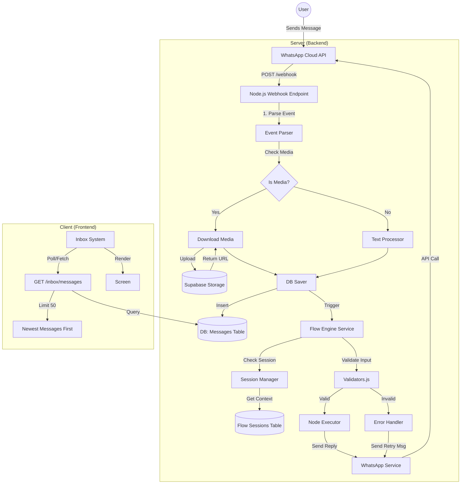
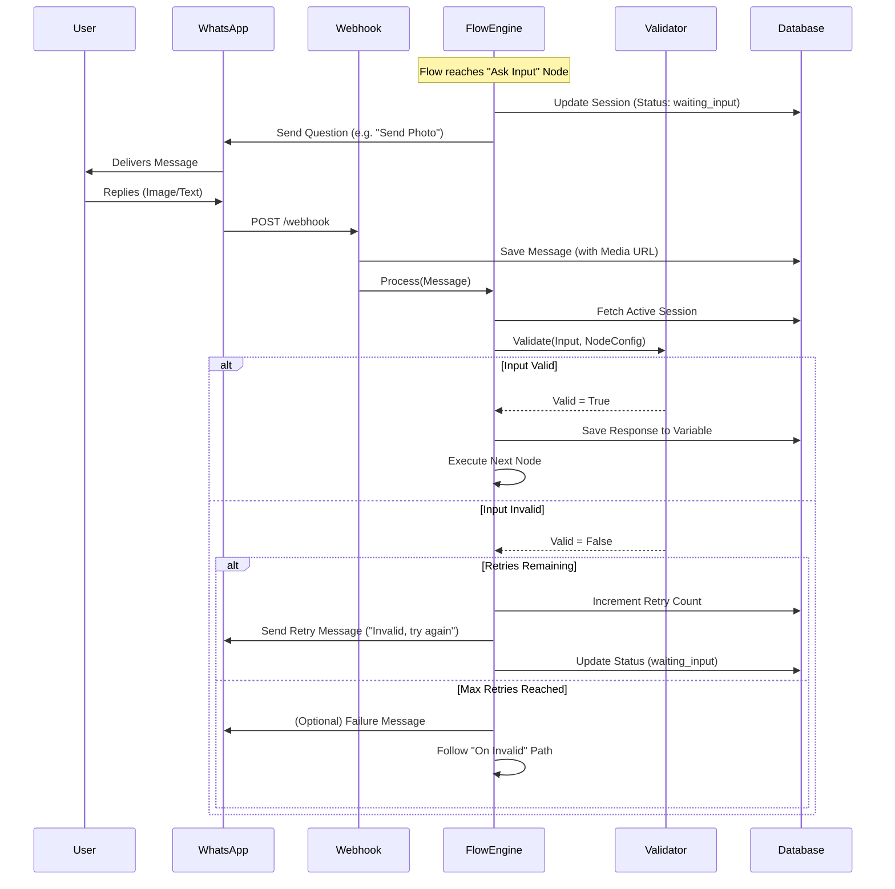

# Troubleshooting & Debugging Guide

## 1. How to Debug Common Issues

### Issue: "My Image is not showing in the Inbox"
**Diagnostics:**
1.  **Check Server Logs**:
    *   Look for `[Inbox] Fetched...` logs.
    *   Check if `Newest Message` log shows a `URL`.
    *   *If URL is null*: The webhook failed to save the media URL. Check `server/routes/webhook.js` logs for "Media uploaded to Supabase".
2.  **Check Database**:
    *   Run `node debug_messages.js` to inspect the last 5 messages in the DB.
    *   Confirm `media_url` column is populated for the latest message.
3.  **Check Supabase Storage**:
    *   Go to Supabase Dashboard -> Storage -> `campaign-media`.
    *   Verify the file exists in the `inbound` folder.

### Issue: "Flow stuck on 'Waiting Input' / Not Responding"
**Diagnostics:**
1.  **Check Flow Session**:
    *   Look at `flow_sessions` table in Supabase.
    *   Check `status` column. Is it `waiting_input`?
2.  **Check Logs**:
    *   Filter server logs for `[FlowEngine]`.
    *   Ensure `Processing message from...` appears when you send a reply.
    *   If you see `No matching flow found... and no active session`, the session ID might have been lost or the phone number doesn't match.

### Issue: "Validation always fails"
**Diagnostics:**
1.  **Check Regex**:
    *   In the Flow Builder, check the "Validation Regex" setting for the Ask Input node.
    *   Ensure it's a valid Javascript Regex string (without the surrounding `/ /`).
    *   *Example Correct*: `^\d{3}$` (for 3 digits).
    *   *Example Incorrect*: `/^\d{3}$/` (some parsers fail on this).

---

# Architecture Diagram (Mermaid)

---

# Flow Diagram: Ask Input Logic

